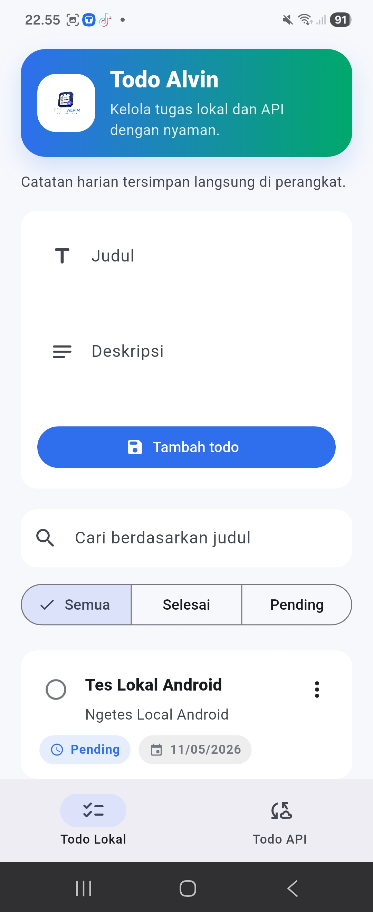
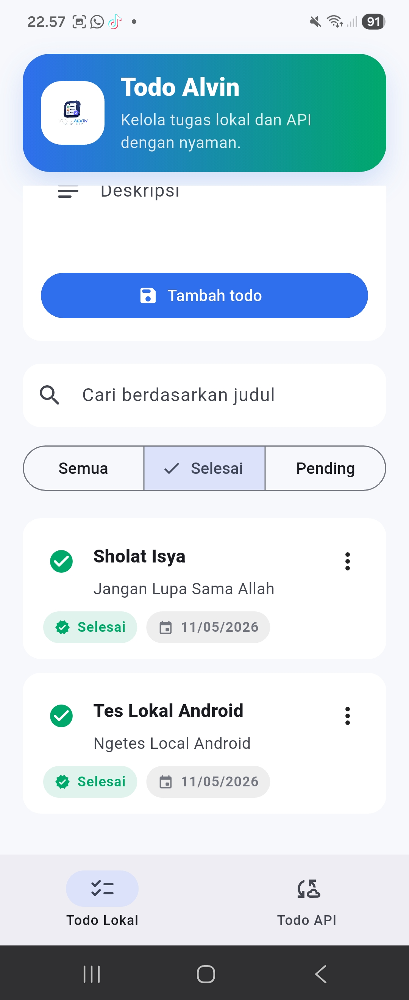
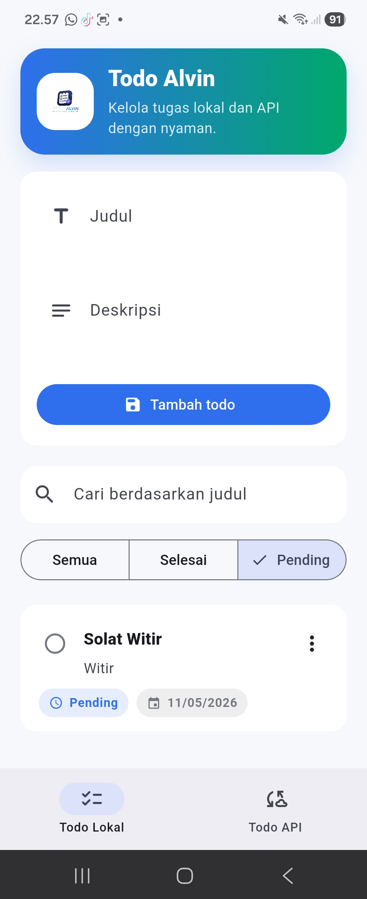
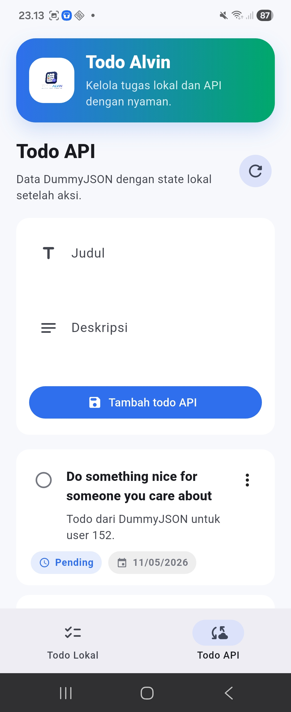
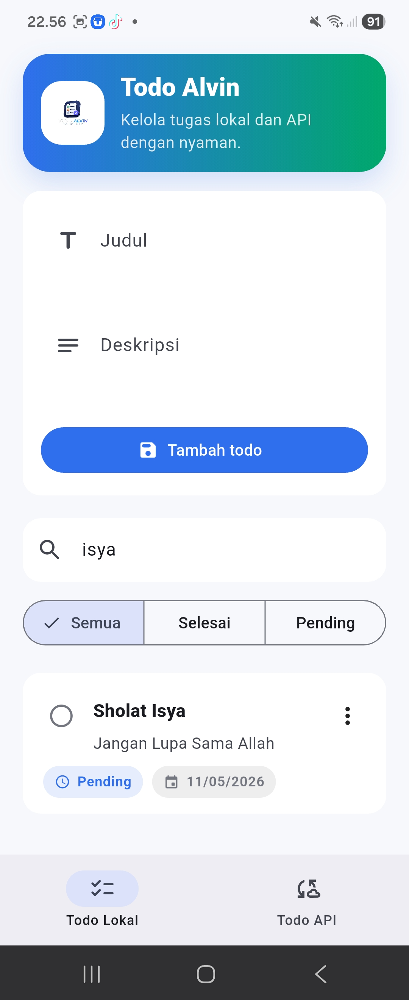
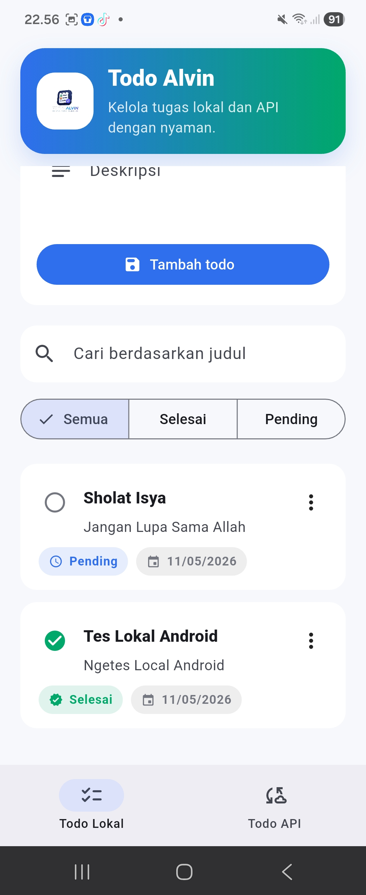
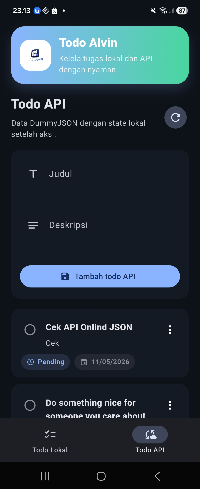
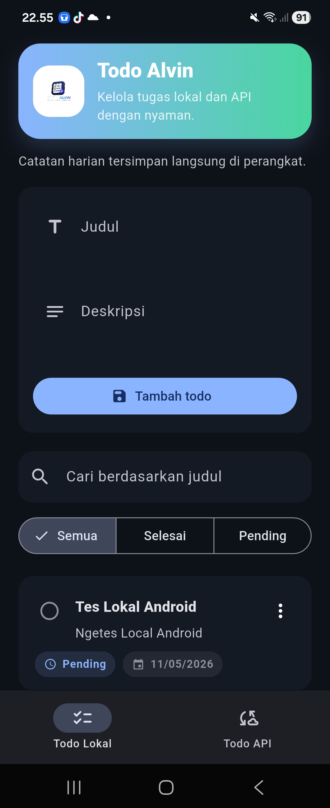

# 📱 Todo Alvin - Flutter Dual-Persistence Todo Application

<p align="center">
  
  
  
  
  
</p>

---

## 📌 Ringkasan Proyek

**Todo Alvin** adalah aplikasi mobile modern berbasis **Flutter & Dart** yang dirancang untuk mengelola daftar tugas (Todo) dengan arsitektur **Dual-Persistence**:
1. **Mode Lokal (Offline-First):** Penyimpanan lokal instan berbasis `SharedPreferences` dalam format JSON terserialisasi.
2. **Mode Cloud / Remote API:** Integrasi RESTful API menggunakan `DummyJSON Todos API` dengan dukungan pagination, pull-to-refresh, dan optimistic local state updates.

Aplikasi dibangun dengan standar clean architecture, pemisahan dependensi (DTO, Repository, Service, Controller), dukungan Light & Dark mode otomatis, validasi form, filter & live search, serta UI Bahasa Indonesia yang ergonomis.

---

## 📸 Preview Aplikasi (Screenshots)

### 📂 Mode Todo Lokal (Offline Storage)
| 1. Beranda Todo Lokal | 2. Tambah Todo Baru | 3. Form Input Todo | 4. Filter & Status Tugas |
| :---: | :---: | :---: | :---: |
|  |  |  |  |
| *Daftar tugas lokal & status counter* | *Form modal tambah tugas baru* | *Validasi input judul & deskripsi* | *Penyaringan tugas selesai / aktif* |

### 🌐 Mode Todo Cloud (DummyJSON REST API)
| 5. Integrasi API Remote | 6. Modal Form API | 7. Manajemen Data API | 8. Pagination & Refresh |
| :---: | :---: | :---: | :---: |
|  |  |  |  |
| *Fetch data dari DummyJSON* | *Input tugas baru via POST API* | *Update & Delete responsif* | *Load more pagination & refresh* |

---

## ✨ Fitur Utama

- 💾 **Offline-First Todo (SharedPreferences):** Data tugas lokal tersimpan aman di internal storage perangkat, tetap tersimpan saat aplikasi ditutup/reboot.
- 🌐 **Remote RESTful API (DummyJSON):**
  - Mengambil data tugas publik (`GET /todos?limit=10&skip=0`).
  - Menambah tugas baru (`POST /todos/add`).
  - Mengubah status tugas (`PUT /todos/{id}`).
  - Menghapus tugas (`DELETE /todos/{id}`).
  - Dynamic pagination (Load More / Infinite Scrolling).
- 🔍 **Live Search & Status Filtering:** Cari tugas berdasarkan kata kunci judul dan filter berdasarkan status (*Semua, Aktif, Selesai*).
- 🌓 **Dynamic Theme (Adaptive Light & Dark Mode):** Menyesuaikan otomatis dengan tema sistem Android / iOS.
- 🧩 **Clean Modular Architecture:** Pemisahan ketat antara lapisan presentasi, domain, dan data layer.
- 🔄 **Optimistic UI Updates:** Memperbarui antarmuka pengguna seketika setelah API response untuk pengalaman pengguna yang cepat dan mulus.

---

## 🛠️ Tech Stack & Dependencies

| Kategori | Teknologi | Deskripsi / Peran |
| :--- | :--- | :--- |
| **Framework** | [Flutter 3.x](https://flutter.dev/) | Cross-platform SDK untuk UI performa tinggi |
| **Bahasa Pemrograman** | [Dart](https://dart.dev/) | Bahasa pemrograman bertipe kuat (*type-safe*) |
| **Local Storage** | `shared_preferences` | Penyimpanan key-value lokal di perangkat |
| **HTTP Client** | `http` package | Client HTTP untuk komunikasi RESTful API |
| **Design System** | Material Design 3 | Komponen UI modern, fluid layout, responsive cards |
| **API Provider** | [DummyJSON](https://dummyjson.com/todos) | Backend mock REST API untuk simulasi CRUD online |

---

## 🏗️ Struktur Arsitektur Direktori

```text
lib/
├── core/
│   ├── constants/       # Konstanta warna, ukuran, dan string
│   ├── theme/           # Konfigurasi tema Light & Dark Material 3
│   └── utils/           # Helper fungsi, formatter tanggal & string
├── data/
│   ├── models/          # Entitas model Todo & DTO serializer
│   ├── repositories/    # Abstraksi data layer (Local & Remote Repository)
│   └── services/        # Service HTTP API & SharedPreferences storage handler
└── presentation/
    ├── controllers/     # State management & business logic handler
    ├── pages/           # Layar tampilan utama (Local Todo & API Todo)
    └── widgets/         # Reusable UI components (Card, Header, EmptyState, Modal)
```

### Pola Aliran Data (Data Flow):
```text
[UI / Presentation Widget] 
       ↓ (Event/Action)
[Controller / State Manager] 
       ↓ (Request Data)
[Repository Abstraction] 
       ↓ (Fetch / Store)
[Remote Service / Local Storage]
```

---

## 🚀 Panduan Instalasi & Menjalankan Aplikasi

### 1. Prasyarat Sistem
- **Flutter SDK:** versi `^3.0.0` atau terbaru ([Panduan Instalasi Flutter](https://docs.flutter.dev/get-started/install))
- **Android Studio** atau **VS Code** dengan ekstensi Flutter & Dart terpasang
- **Android SDK & Emulator** (atau gunakan perangkat fisik Android dengan mode *USB Debugging* aktif)

Periksa kesiapan environment dengan perintah:
```bash
flutter doctor
```

### 2. Clone Repository
```bash
git clone git@github.com:ahmadalvin92/flutter-todo-api-crud-assessment-by-alvin.git
cd flutter-todo-api-crud-assessment-by-alvin
```

### 3. Unduh Dependensi
```bash
flutter pub get
```

### 4. Jalankan Aplikasi
Jalankan aplikasi di emulator atau perangkat yang terhubung:
```bash
# Debug Mode
flutter run

# Atau tentukan target device spesifik
flutter devices
flutter run -d <DEVICE_ID>
```

### 5. Build APK (Produksi)
Untuk menghasilkan file installer Android APK:
```bash
flutter build apk --release
```
File APK akan tersedia di direktori `build/app/outputs/flutter-apk/app-release.apk`.

---

## 🧪 Pengujian (Testing)

Jalankan automated unit test untuk validasi model dan logika serialisasi:
```bash
flutter test
```

---

## 👨‍💻 Author

**Ahmad Alvin Griffin**
- GitHub: [@ahmadalvin92](https://github.com/ahmadalvin92)
- Email: ahmadalvin92@gmail.com
